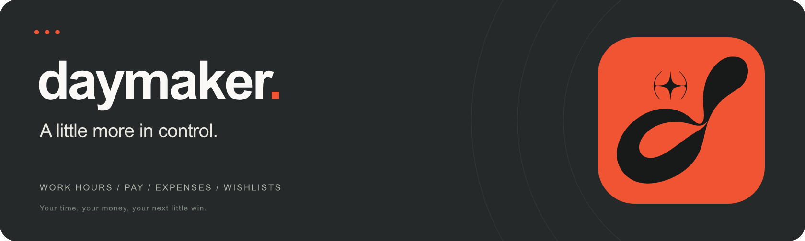
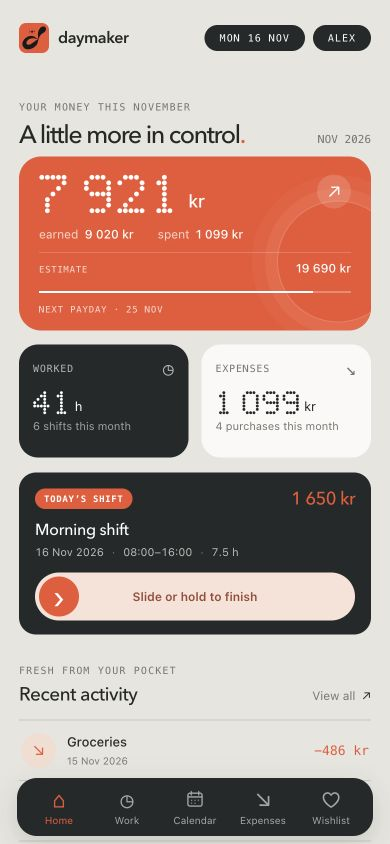
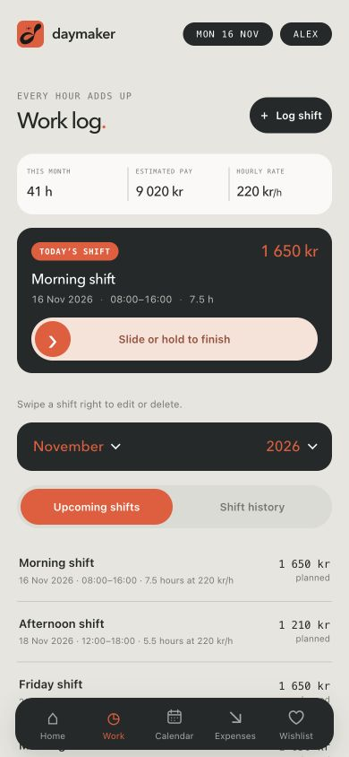
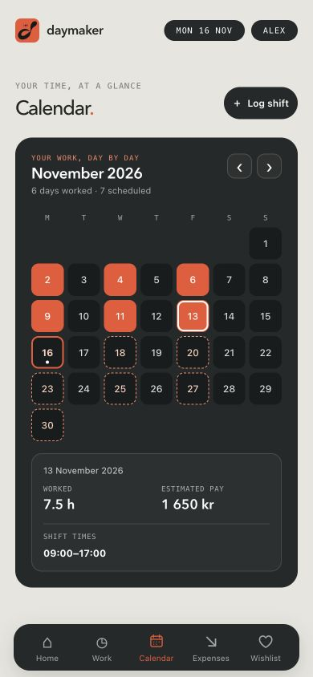
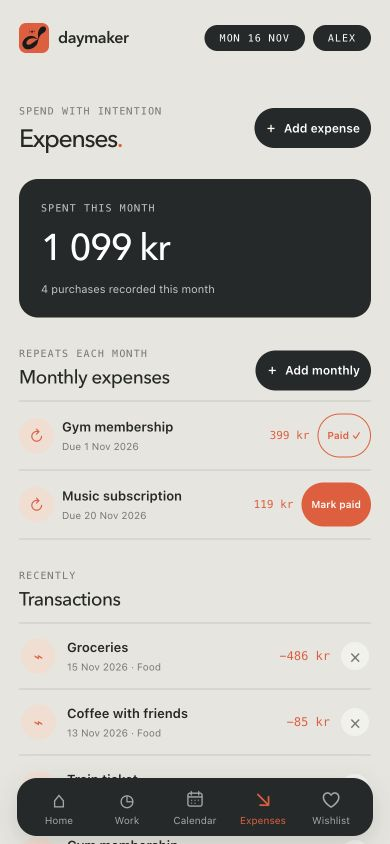
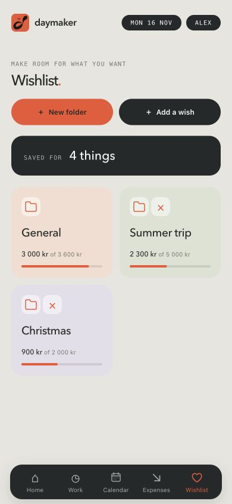
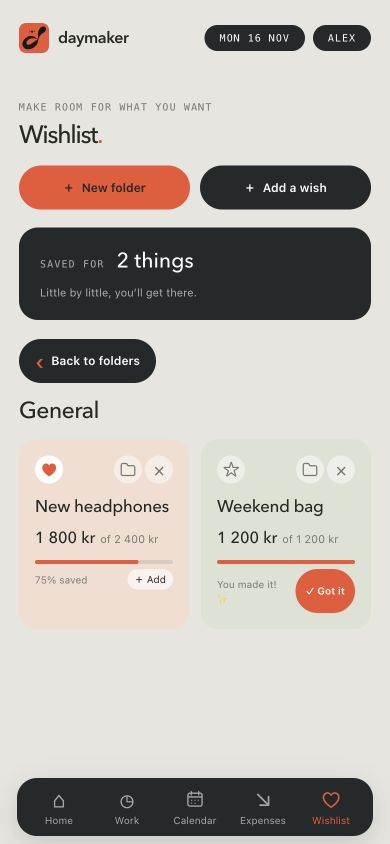

<p align="center">
  
</p>

# Daymaker

A little more in control of your time, your money and the things you want.

Daymaker is a mobile-first app for tracking work hours, estimated earnings, everyday spending and savings goals. Plan a shift, finish your workday with a swipe, keep monthly bills in view and save towards your next little win.

**[Open Daymaker →](https://xiteka.github.io/Daymaker/)** · [Install on iPhone](#install-on-iphone) · [Screenshots](#screenshots) · [Run locally](#run-locally)

## Screenshots

Real app screens at an iPhone-sized viewport. All names, shifts, amounts and wishes below are **fictional demonstration data**, captured in November 2026.

<table>
  <tr>
    <th>Home</th>
    <th>Work log</th>
    <th>Calendar</th>
  </tr>
  <tr>
    <td width="33%"></td>
    <td width="33%"></td>
    <td width="33%"></td>
  </tr>
  <tr>
    <th>Expenses</th>
    <th>Wishlist folders</th>
    <th>Savings goals</th>
  </tr>
  <tr>
    <td></td>
    <td></td>
    <td></td>
  </tr>
</table>

## What you can do

| Area | Features |
| --- | --- |
| **Home** | See money earned and spent this month, worked hours, estimated earnings, the next payday, today's or the next shift, recent activity and a favourite wish. |
| **Work** | Schedule shifts with start/end times, a title, hourly rate and paid or unpaid breaks. Swipe or hold to finish today's shift, adjust actual hours or earnings, and browse upcoming shifts or history by month and year. |
| **Calendar** | See completed and planned workdays. Tap a day on a phone or hover on a computer for hours, earnings and shift times. Log a shift directly for the selected date. |
| **Expenses** | Log everyday purchases and recurring monthly bills, choose due days, mark bills paid and review transactions. |
| **Wishlist** | Organise wishes into General or custom folders, add savings, favourite an item for Home and mark a funded wish purchased. Purchases become expenses and stay in the folder's purchased history. |
| **Account & friends** | Save a nickname, change settings, sync an account, download backups, add friends by email and optionally view shared shift calendars. |
| **iPhone reminders** | Opt in to a work reminder 60 minutes before a shift, using the installed Home Screen app and notification permission. |

### How shift totals work

- Only **completed shifts** count towards worked hours and earned pay. The monthly estimate also includes upcoming shifts.
- New shifts use your saved hourly rate. The initial default is **220 NOK/hour**; the default payday is the **25th**. Both can be changed in **Account → Your settings**.
- A shift of **6 hours or longer** suggests a 30-minute unpaid break. Shorter shifts leave it blank. You can override the break or mark it paid.
- When you finish a shift, adjust the actual times and break. Completed shifts also support a manual earned amount, which updates the totals throughout the app.
- Missed completion can be handled later from Work. Swiping a shift reveals edit/delete actions, and deletion asks for confirmation.
- Earnings are estimates based on the recorded rate and paid hours. Tax and overtime premiums are not calculated automatically.

## Install on iPhone

1. Open **[Daymaker](https://xiteka.github.io/Daymaker/)** in Safari.
2. Tap **Share → Add to Home Screen**.
3. Add Daymaker, then launch it from its new icon.
4. To use work reminders, log in and enable them from Account, then allow notifications when prompted.

Daymaker is a **Progressive Web App (PWA)**. Its app shell is cached for offline use; account sync and push reminders need an internet connection. The repository also includes an Electron desktop wrapper. It currently has no native iOS/Xcode app or Home Screen widget.

## Your data

You can use Daymaker without an account: guest data stays in that browser's local storage. With Supabase login, existing device records are merged into the account, subsequent edits sync, and offline edits retry after reconnecting. Device and account backups are available from Account.

Friends' calendar sharing requires both people to enable it. Shared calendar results contain a nickname, shift date and start/end times; earnings, expenses and wishlist contents are not included.

For database, authentication, email and reminder configuration, see [Supabase setup](supabase/README.md), [friend requests](supabase/friends.sql) and [calendar sharing](supabase/friend-calendars.sql).

## Visual identity

Rounded cards, a warm stone background, dark navigation, dotted numbers and an orange accent keep the interface consistent across pages.

<p>
  
</p>

| Orange | Stone | Ink |
| --- | --- | --- |
| `#F05432` | `#E6E5E0` | `#242824` |

The [scalable logo master](src/icons/daymaker-spark.svg), app icon exports and [branding notes](branding/README.md) are included in the repository.

## Run locally

The web app uses plain HTML, CSS and JavaScript. From the repository root, serve `src/` with a local HTTP server, for example:

```sh
python3 -m http.server 4173 --bind 127.0.0.1 --directory src
```

Open **http://localhost:4173**. Use localhost for development and HTTPS for installation on a phone; opening `index.html` through `file://` does not enable service workers.

For the Electron desktop wrapper, use Node.js **22.13+** and npm **10.9+**:

```sh
npm ci
npm start
```

### Project layout

```text
src/          Web app source, icons, manifest and service worker
docs/         Published copy served by GitHub Pages
branding/     Approved logo concept, branding notes and README images
supabase/     Database SQL, authentication notes and reminder function
main.cjs      Electron desktop entry point
```

### Publish with GitHub Pages

The [Publish Daymaker workflow](.github/workflows/pages.yml) publishes `docs/` when `main` changes. For app releases, keep changed files in `src/` and `docs/` in sync, update the relevant asset versions and service-worker cache, then push to `main`. Wait for the workflow to succeed before checking the live app.

README images live in `branding/readme/`; updating documentation does not require changing the app cache or users' stored data.
